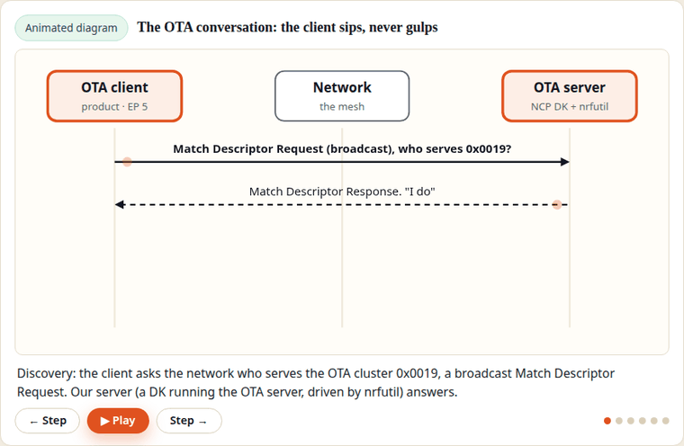

# Zigbee, Engineered — Course Repository

Companion code for **Zigbee, Engineered**, a project-based course that builds a
Zigbee router device end to end: an nRF52840 with an HLK-LD2410 mmWave presence
sensor that reports occupancy and controls a store-bought IKEA Zigbee bulb —
commissioning, a custom Occupancy Sensing endpoint, reporting and binding,
MCUboot + Zigbee OTA updates, and a Wireshark sniffer capstone.



*One of the course's animated lesson diagrams (not hardware footage): the OTA
conversation from Chapter 10, stepped through frame by frame. The lessons
animate the hard parts like this throughout, and hand you the controls.*

## Start here

**The full guided project lives at [Bit to Board](https://bittoboard.com/zigbee-engineered/)** —
this repository is its companion code, public so you can inspect exactly what
you will build before deciding anything. Bit to Board is project-based
learning: you learn embedded systems by building real projects end to end.

- **The project:** [Zigbee, Engineered](https://bittoboard.com/zigbee-engineered/) — the guided build this repo belongs to.
- **Free, in full:** the [Guides](https://bittoboard.com/guides/) — full-depth procedures in the same style as the lessons, including [Write a Zephyr device driver from scratch](https://bittoboard.com/guides/zephyr-driver-from-scratch/) and [Create Zephyr board files from scratch](https://bittoboard.com/guides/zephyr-board-files-from-scratch/).
- **New releases and posts:** the [Bit to Board newsletter](https://bittoboard.com/newsletter/) — one email when there is something worth saying.

## Structure

Each chapter's exercises live in their own folder, one folder per step:

```
ch01/step-01-hello-logging
ch01/step-02-shell-command
...
ch11/step-02-decode-your-network
```

Every step is a standalone Zephyr application with its own README: what to
build, what you should see, and why. Work through them in order — later steps
build on the concepts (and sometimes the code) of earlier ones.

## Pinned stack

| Piece | Version |
|---|---|
| nRF Connect SDK (NCS) | v3.4.1 |
| Zigbee add-on (ncs-zigbee / ZBOSS) | v1.4.0 |
| Zephyr | 4.4.2 (as carried by NCS v3.4.1) |
| Board | `nrf52840dk/nrf52840` (coordinator/sniffer steps use the nRF52840 dongle, as the lessons specify) |

## Getting started

Follow Chapter 1 of the course: install the toolchain, set up the NCS
workspace, then clone this repository into the **root of the workspace** and
name the folder `repo`:

```sh
git clone https://github.com/learnbittoboard/zigbee-engineered.git repo
```

Build any step from inside the workspace, for example:

```sh
west build -p always -b nrf52840dk/nrf52840 -d build/ch01-step01 repo/ch01/step-01-hello-logging
```

## The companion repo

[embedded-devops-engineered](https://github.com/learnbittoboard/embedded-devops-engineered)
takes this repo's finished product and builds a delivery factory around it:
a pinned Docker toolchain, Jenkins and GitHub Actions pipelines, host tests,
signing, releases, and hardware-in-the-loop checks.
